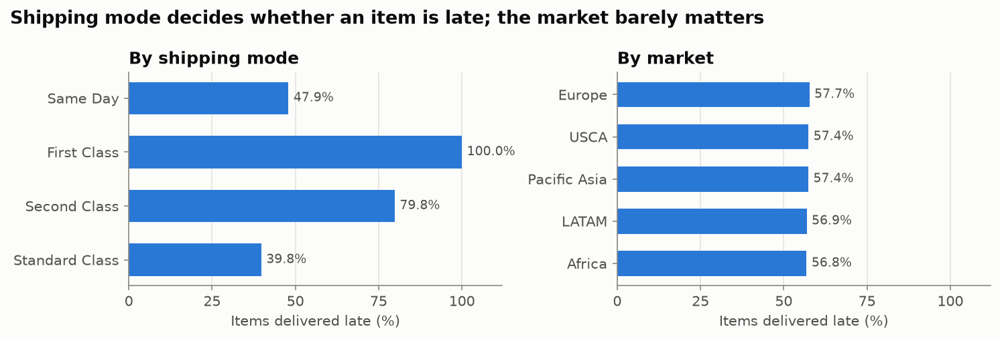
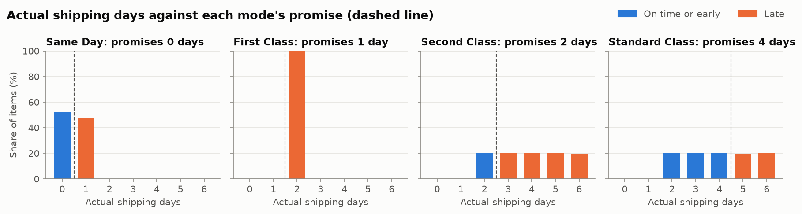
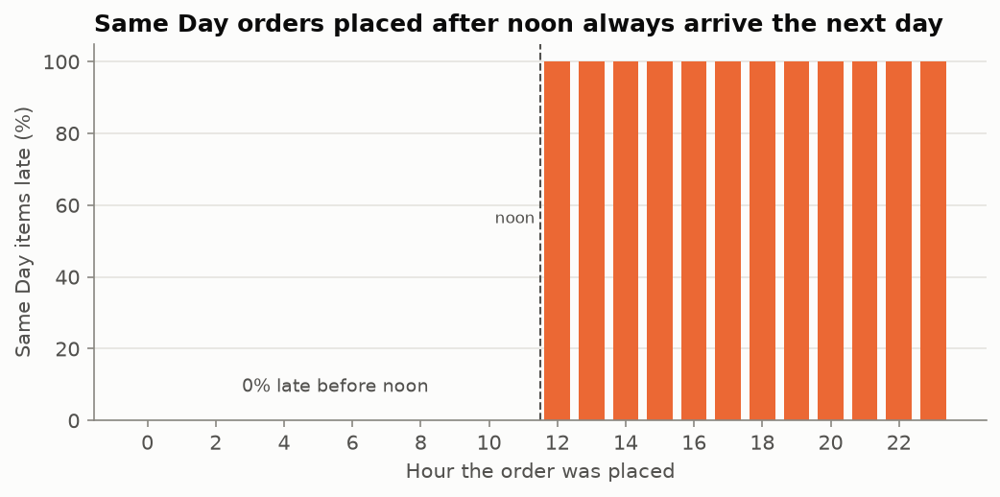
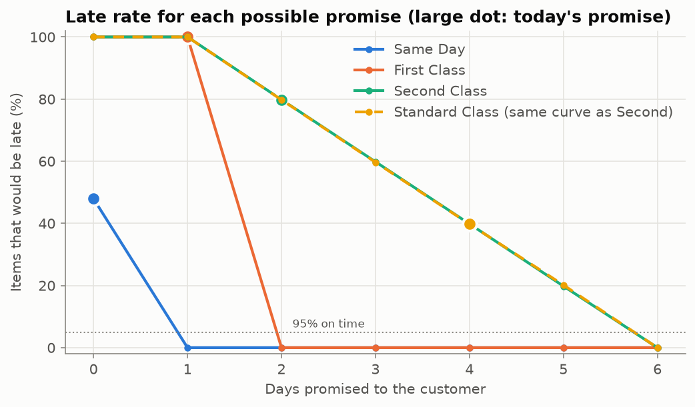
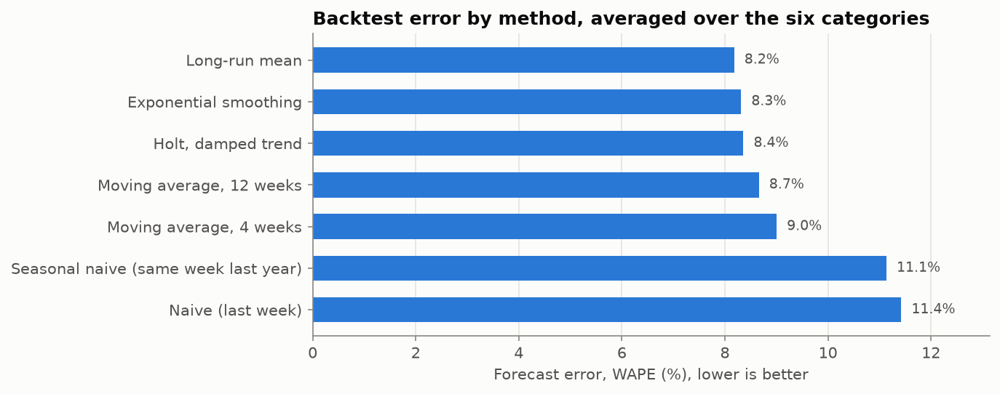
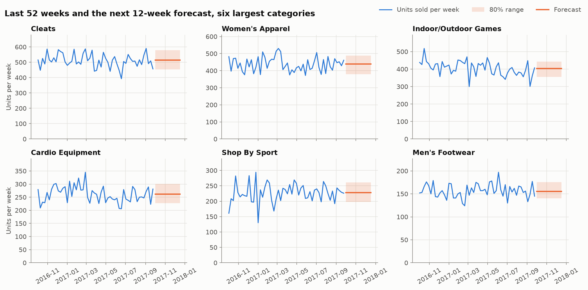

# Supply chain analytics: late deliveries and demand forecasting

An analysis of 180,519 order items from DataCo, a public supply chain dataset
covering January 2015 to January 2018, to answer two operations questions:

1. **Why are more than half of deliveries late, and what would fix it?**
2. **How well can weekly demand be forecast, and how much safety stock does that call for?**

Python (pandas, scikit-learn, statsmodels) for the analysis, and a Power BI
dashboard built from the tables it exports.

## Findings

### 1. Late deliveries come from the promise, not the region

57.3% of shipped items arrive later than the customer was promised. The late
rate is almost entirely set by the shipping mode: it ranges from 39.8% to
100% across modes, but varies by less than one percentage point across
markets and customer segments.



Each mode promises a fixed number of days, and the actual times don't match:

| Shipping mode | Promised | Actual | Late |
|---|---|---|---|
| Same Day | 0 days | 0 or 1 day | 47.9% |
| First Class | 1 day | always 2 days | 100% |
| Second Class | 2 days | 2 to 6 days, evenly spread | 79.8% |
| Standard Class | 4 days | 2 to 6 days, evenly spread | 39.8% |



Same Day has a clean cutoff: orders placed before noon arrive the same day,
and orders placed at noon or later arrive the next day, which is always late.



**What would fix it.** Two changes to what customers are promised, without
changing how anything ships:

| Scenario | Late rate |
|---|---|
| Today | 57.3% |
| First Class promises 2 days instead of 1 | 41.9% |
| ...and Same Day orders after noon are promised next day | 39.4% |

Second and Standard Class take the same 2 to 6 days, so Second Class customers
pay for a faster service they don't get. Reaching 95% on time for those modes
would mean promising 6 days, so the real fix there is operational: reducing
the spread of shipping times, not changing the promise.



**Can lateness be predicted when the order is placed?** Trained on 2015–2016
and tested on 2017–2018:

| Model | Accuracy | ROC AUC |
|---|---|---|
| Always predict "late" | 57.0% | 0.50 |
| Shipping mode only | 69.4% | 0.74 |
| Shipping mode + ordered before/after noon | 72.2% | 0.77 |
| Gradient boosting on 13 order-time features | 72.1% | 0.77 |
| Gradient boosting plus actual shipping days (leaky) | 100% | 1.00 |

A two-fact rule does as well as gradient boosting on 13 features: once the
shipping mode and the order time are known, nothing else in the data predicts
lateness. The last row shows why the split between order-time and
after-the-fact information matters. Actual shipping days are only known after
delivery, and including them gives a "perfect" model that can't be used.

### 2. Weekly demand is stable, so simple forecasts win

Weekly units for the six largest categories (76% of units sold) show no trend
and no yearly seasonality. In a backtest that forecast 12 weeks ahead from four
different starting points, seven methods compared as follows:



The long-run mean has the lowest average error (8.2% WAPE), with exponential
smoothing (8.3%) and damped Holt (8.4%) close behind. Using last week's value
does worst (11.4%). Using the long-run mean for every category cuts the error by
9% to 38% compared with last week's value, and is within 0.2 points of each
category's own best method. Picking a different method for each category would
be fitting noise.



The backtest errors then set safety stock: 95% service level, assuming a
2-week replenishment lead time (the dataset has no supplier lead times, so
this is an assumption).

| Category | Forecast per week | Safety stock | Reorder point |
|---|---|---|---|
| Cleats | 513 | 103 | 1,130 |
| Women's Apparel | 438 | 97 | 974 |
| Indoor/Outdoor Games | 403 | 91 | 896 |
| Cardio Equipment | 261 | 70 | 593 |
| Shop By Sport | 228 | 67 | 523 |
| Men's Footwear | 155 | 35 | 345 |

## About the data

[DataCo Smart Supply Chain for Big Data Analysis](https://data.mendeley.com/datasets/8gx2fvg2k6/5)
by Fabian Constante, Fernando Silva and António Pereira (Mendeley Data, version 5,
CC BY 4.0). One row per order item.

Limits worth knowing:

- **The data changes from October 2017**: one item per order instead of about
  three, around 80% fewer units, and mostly different product categories. The
  forecast uses only data before that. The late-delivery results hold in both
  periods.
- **Shipping times look generated**: Second and Standard Class are spread
  exactly evenly over 2 to 6 days. The findings describe this dataset; with
  real carrier data, the same analysis would also need to model carriers,
  distance and capacity.
- Personal columns (masked emails and passwords, names, street addresses) are
  dropped when loading.

## Run it

Tested with Python 3.14.

```bash
python -m venv .venv
.venv\Scripts\activate            # Windows; on macOS/Linux: source .venv/bin/activate
pip install -r requirements.txt
```

Download `DataCoSupplyChainDataset.csv` from the link above into `data/raw/`, then:

```bash
python src/late_deliveries.py     # late-delivery analysis, charts, results
python src/forecast.py            # forecast backtest, forecast, safety stock
python src/export_powerbi.py      # tables for Power BI
```

Results are written to `outputs/` (with the full numbers in
`late_deliveries_results.md` and `forecast_results.md`) and charts to `figures/`.
[docs/powerbi_dashboard.md](docs/powerbi_dashboard.md) explains how to build the
dashboard from `outputs/powerbi/`.

## Project layout

```
src/data.py              loading and cleaning, shared by every script
src/late_deliveries.py   late rates, shipping times, what-if, prediction models
src/forecast.py          weekly demand, backtest, forecast, safety stock
src/export_powerbi.py    tables for the dashboard
src/style.py             chart styling
docs/                    Power BI build guide
outputs/                 results (CSV and Markdown)
figures/                 charts
```
